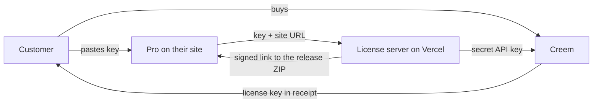

# Licensing & Updates

Hooked on Facets is GPL-2.0-or-later. Checkout, license keys and updates for the paid **Hooked on Facets Pro** add-on run on [Creem](https://creem.io), through a small license server Shepdesign runs on Vercel.

## How it fits together

- **Hooked on Facets (free, WordPress.org)** contacts no outside service. Its **License** screen is where the Pro key goes. Free updates come from WordPress.org.
- **Hooked on Facets Pro (paid add-on)** sends the key and the site URL to the license server, which checks them with Creem. Creem's license API needs the store's secret key, so the server, not the plugin, talks to Creem.
- **Updates.** Pro asks the server for the newest GitHub release of the Pro repo. Every site sees that an update exists. Only an active license gets the download, through a link signed for one hour.

## For site owners

1. Buy Pro, then install the ZIP from your purchase email.
2. Go to **Hooked on Facets → License**, paste the license key from your receipt, and click **Activate**.
3. Pro updates then appear on the WordPress Updates screen like any other plugin.

The License screen shows the status, the key's last four characters, how many sites use it, and the renewal date.

- **Check again** re-asks the server, for example after a renewal.
- **Deactivate on this site** frees the slot for another site.

An unlicensed or expired Pro keeps working; it just stops receiving updates. Billing and renewals are handled from the link in the Creem receipt email.

## Configuration

| Where | Name | What |
|---|---|---|
| Pro, `wp-config.php` | `HOF_PRO_LICENSE_SERVER` | License server URL. Defaults to `https://shepdesign-license-server.vercel.app`; `''` switches licensing and updates off. |
| Pro, `wp-config.php` | `HOF_PRO_UPDATE_CHANNEL` | `stable` or `beta`. Defaults to `beta` on a pre-release build, else `stable`. |
| Vercel | `CREEM_MODE`, `CREEM_API_KEY`, `CREEM_PRODUCT_HOOKED_ON_FACETS_PRO`, `GITHUB_TOKEN`, `DOWNLOAD_SIGNING_SECRET` | See `license-server/README.md` in the Pro repo. |

**The Creem API key and the GitHub token live only in Vercel.** Never commit them or put them in a plugin.

## For the store operator (Shepdesign, LLC)

Follow [Set up hooked on facets Pro in Creem](creem-setup.md) step by step. In short:

1. Create the Pro product in Creem with a license key delivery.
2. Deploy `license-server/` from the Pro repo to Vercel with its five variables.
3. Release Pro by bumping its version on `main`. The workflow publishes the GitHub release that the server serves. Nothing needs uploading.

## Notes

- Before 1.6.0 the free plugin bundled the Freemius SDK and Pro 1.3 licensed through it. Both are gone. On core 1.6.0, a site still on Pro 1.3 sees "Update Hooked on Facets Pro" on the License screen.
- There is no root `uninstall.php`. Data cleanup is `hof_uninstall()`, registered as the uninstall hook on activation.

See the [Launch Checklist](launch-checklist.md) for the full runway.
